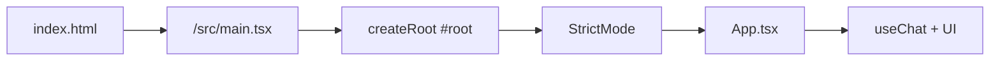
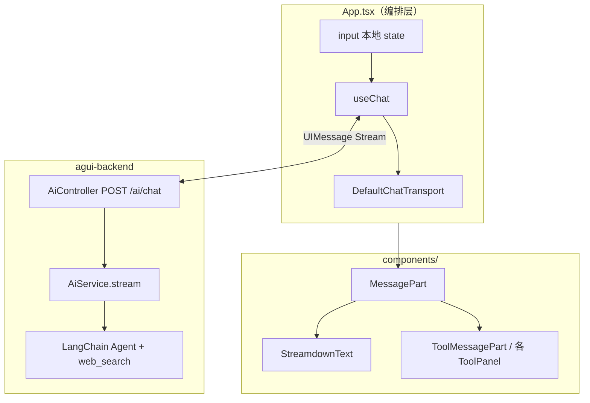
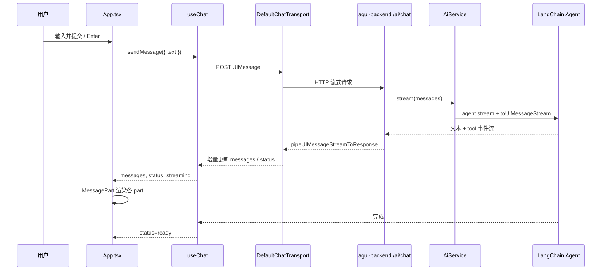
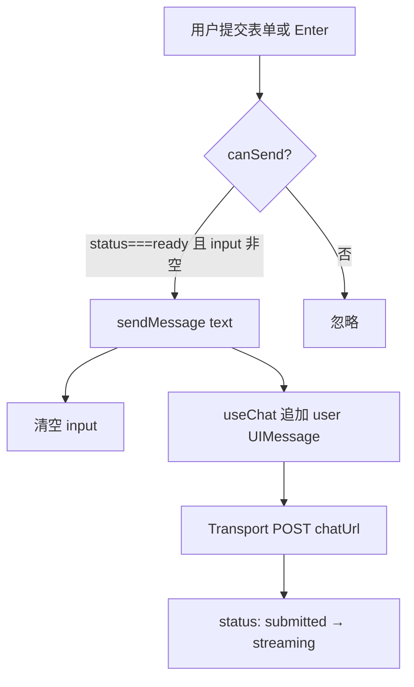
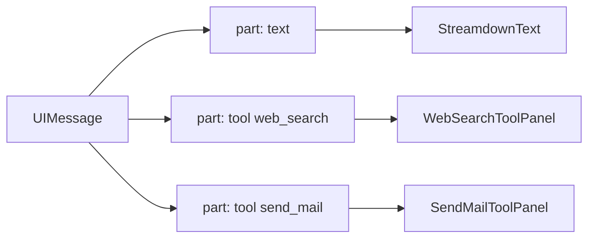
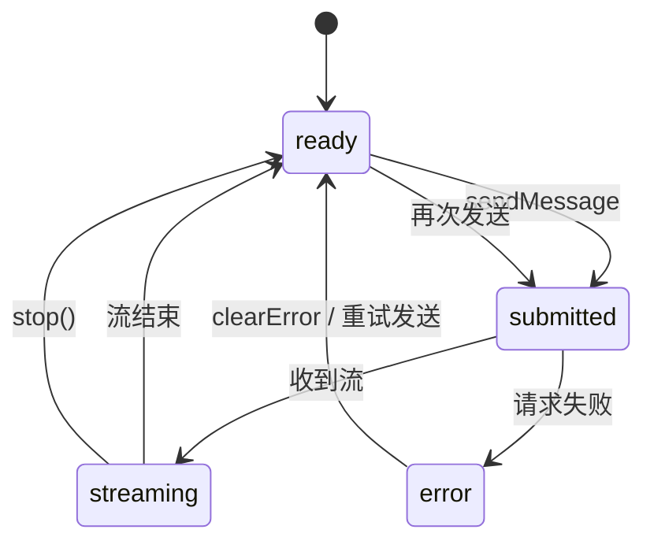
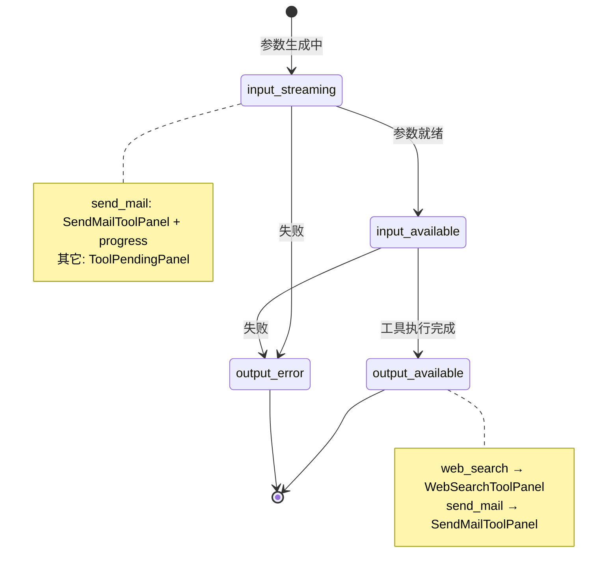
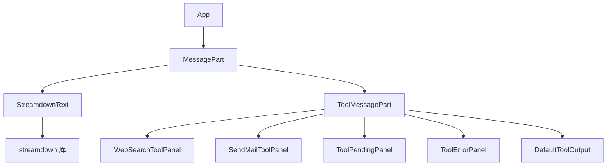
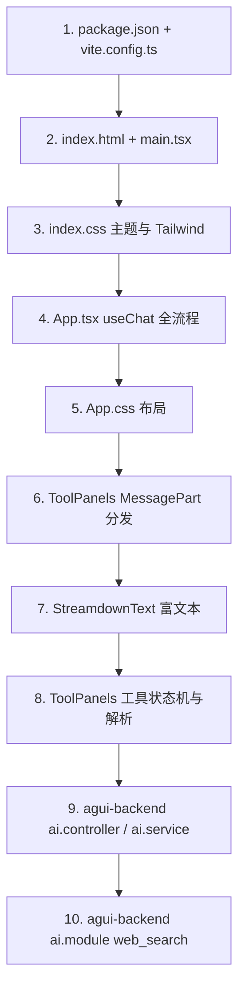

# agui-frontends 深度学习导览

> **会话**: ANL-2026-05-22-ai-frontend-code-learning  
> **范围**: 项目结构、运行入口、核心模块、AI 交互链路、状态管理、UI 组件、阅读路线  
> **说明**: 仅代码分析，不修改业务代码。后端 `agui-backend` 作为链路对照一并说明。

---

## 1. 项目概览

`agui-frontends` 是一个基于 **Vite + React 19 + TypeScript** 的 AI 聊天前端。它通过 Vercel **AI SDK**（`ai` + `@ai-sdk/react`）与本地 NestJS 后端 `agui-backend` 通信，消费 **UIMessage 流式协议**，并把助手回复拆成 **文本块** 与 **工具调用块** 分别渲染。

| 维度 | 说明 |
|------|------|
| 定位 | 学习型 Demo：单页聊天 UI，无路由、无全局 Store |
| 后端 | `http://localhost:3001/ai/chat`（`App.tsx` 中 `API_BASE`） |
| 流式 | HTTP + AI SDK `DefaultChatTransport` + `useChat` |
| 富文本 | `streamdown` 渲染 Markdown / 代码高亮 / Mermaid |
| 工具 UI | `web_search`、`send_mail` 专用面板（后端当前仅注册 `web_search`） |

---

## 2. 技术栈

| 层级 | 依赖 | 作用 |
|------|------|------|
| 构建 | Vite 8、`@vitejs/plugin-react` | 开发服务器、HMR、打包 |
| 样式 | Tailwind CSS 4（`@tailwindcss/vite`） | 工具类；`index.css` 扫描 Streamdown 源码 |
| React | react 19 | UI |
| AI 客户端 | `ai`、`@ai-sdk/react` | `useChat`、`DefaultChatTransport`、`UIMessage`、工具 Part 类型 |
| 渲染 | `streamdown`、`@streamdown/code`、`@streamdown/mermaid` | 流式 Markdown、Shiki、图表 |

---

## 3. 项目结构

```
agui-frontends/
├── index.html              # HTML 壳，挂载 #root，加载 /src/main.tsx
├── vite.config.ts          # React + Tailwind 插件
├── package.json
├── public/                 # favicon、icons
└── src/
    ├── main.tsx            # React 入口
    ├── index.css           # 全局主题、Tailwind、Streamdown @source
    ├── App.tsx             # 聊天主界面 + useChat 编排
    ├── App.css             # 聊天气泡、表单、布局
    └── components/
        ├── StreamdownText.tsx   # 文本 Part → Markdown 流式渲染
        ├── StreamdownText.css
        ├── ToolPanels.tsx       # 工具 Part 路由 + web_search / send_mail 面板
        └── ToolPanels.css
```

**特点**：逻辑高度集中在 `App.tsx` 与 `ToolPanels.tsx`，无 `hooks/`、`store/`、`api/` 分层——适合先读懂再扩展。

---

## 4. 运行入口与启动流程

### 4.1 构建与脚本

```json
"dev": "vite",
"build": "tsc -b && vite build",
"preview": "vite preview"
```

### 4.2 运行时加载链



| 文件 | 职责 |
|------|------|
| `index.html` | `<div id="root">` + `type="module"` 指向 `main.tsx` |
| `main.tsx` | `createRoot` 挂载 `App`，引入 `index.css` |
| `vite.config.ts` | `react()` + `tailwindcss()`，无自定义 proxy（API 直连后端） |

### 4.3 本地联调

1. 启动后端：`agui-backend` 默认端口 **3001**（`main.ts`：`process.env.PORT ?? 3001`）
2. 启动前端：`npm run dev`（Vite 默认 **5173**）
3. 确保 `App.tsx` 中 `API_BASE` 与后端一致；后端已 `enableCors({ origin: '*' })`

---

## 5. 核心模块职责



| 模块 | 文件 | 核心 API / 概念 |
|------|------|----------------|
| 传输层 | `App.tsx` | `DefaultChatTransport({ api })` |
| 会话状态 | `App.tsx` | `useChat<UIMessage>({ transport })` → `messages`, `status`, `sendMessage`, `stop`, `error` |
| 输入状态 | `App.tsx` | `useState` 管理 `input`（**不**进入 AI SDK） |
| 消息渲染 | `ToolPanels.tsx` | `MessagePart` 按 `part.type` 分发 |
| 文本渲染 | `StreamdownText.tsx` | `Streamdown` + `isAnimating` / `parseIncompleteMarkdown` |
| 工具渲染 | `ToolPanels.tsx` | `isToolUIPart`、`getToolName`、`part.state` 状态机 |

---

## 6. AI 交互链路（端到端）

### 6.1 总览序列图



### 6.2 前端发送路径



关键代码锚点：

- `API_BASE` / `chatUrl`：`App.tsx` L7–L11
- `transport`：`useMemo(() => new DefaultChatTransport({ api: chatUrl }))`
- `sendMessage`：表单 `onSubmit` 与 `textarea` `onKeyDown`（Enter 无 Shift）

### 6.3 后端处理路径（对照学习）

| 步骤 | 位置 | 说明 |
|------|------|------|
| 接收 | `ai.controller.ts` | `POST /ai/chat`，body `{ messages: UIMessage[] }` |
| 校验 | 同上 | 无 `messages` 数组则 `BadRequestException` |
| 推理 | `ai.service.ts` | `toBaseMessages` → LangChain `createAgent` → `toUIMessageStream` |
| 响应 | `ai.controller.ts` | `pipeUIMessageStreamToResponse({ response, stream })` |
| 工具 | `ai.module.ts` | `web_search` 调用 Bocha API，格式化多段文本返回 |

前端 `ToolPanels.tsx` 中 `parseWebSearchBlocks` 的字段（引用、标题、URL、摘要…）与后端 `ai.module.ts` 格式化字符串 **一一对应**。

### 6.4 UIMessage 与 Part 模型

一条 `UIMessage` 包含：

- `id`、`role`（`user` | `assistant`）
- `parts[]`：多段内容，而非单一 `content` 字符串



`MessagePart` 分发逻辑（`ToolPanels.tsx`）：

- `part.type === 'text'` → `StreamdownText`
- `isToolUIPart(part)` → `ToolMessagePart` → 按工具名与 `part.state` 选面板

---

## 7. 状态管理

本项目 **没有** Redux / Zustand / Context。状态分两层：

### 7.1 AI SDK 托管（`useChat`）

| 状态 | 类型 / 取值 | 用途 |
|------|-------------|------|
| `messages` | `UIMessage[]` | 完整对话历史，含 parts |
| `status` | `ready` \| `submitted` \| `streaming` \| `error` | 控制输入禁用、停止按钮、状态文案 |
| `error` | `Error` \| undefined | 顶部错误条 |
| `sendMessage` / `stop` / `clearError` | 方法 | 发送、中断、清错 |

派生逻辑（`App.tsx`）：

- `busy = submitted || streaming`
- `canSend = ready && input.trim()`
- `lastAssistant`：最后一条助手消息，用于判断 **哪一段 text** 处于流式高亮

### 7.2 组件本地 state

| 状态 | 位置 | 说明 |
|------|------|------|
| `input` | `App.tsx` `useState` | 输入框受控；发送后清空 |
| 无其它全局 UI 状态 | — | 工具面板状态来自 `part.state`，非 React state |

### 7.3 状态机（聊天 status）



### 7.4 工具 Part 状态机（`ToolMessagePart`）



---

## 8. UI 组件组织

### 8.1 布局结构（`App.tsx` + `App.css`）

```
.chat-app
├── .chat-header          # 标题、后端 URL、停止按钮
├── .chat-messages        # 消息列表 role=log
│   └── .chat-bubble--user | --assistant
│       ├── .chat-role
│       └── .chat-body → MessagePart[]
├── .chat-error           # 错误条（可选）
└── .chat-form
    ├── textarea.chat-input
    └── .chat-actions     # status 文案 + 发送按钮
```

### 8.2 组件依赖图



### 8.3 流式文本高亮规则

仅当同时满足时，`StreamdownText` 的 `isStreaming=true`：

1. `part.type === 'text'`
2. `message.role === 'assistant'`
3. `message.id === lastAssistant.id`
4. 当前 part 是该消息 **最后一个 text part**
5. `busy`（`submitted` 或 `streaming`）

这样避免历史助手消息在流式过程中误触发动画。

### 8.4 StreamdownText 要点

- `mode="streaming"`、`parseIncompleteMarkdown`：流式未闭合 Markdown
- `isAnimating={isStreaming}`：打字/过渡动画
- 插件：`mermaid`、`createCodePlugin`（Shiki 双主题 light/dark）

### 8.5 工具面板与后端契约

| 工具名 | 前端类型 | 后端现状 | UI 行为 |
|--------|----------|----------|---------|
| `web_search` | `WebSearchToolInput` / 字符串 output | ✅ `ai.module.ts` 已注册 | 解析多段「引用/标题/URL…」为卡片列表 |
| `send_mail` | `SendMailToolInput` partial | ❌ 未在 `AiService` 注册 | UI 已完整实现流式参数预览；接入后端后即可显示 |
| 其它 | `DefaultToolOutput` | — | JSON / 原始字符串 |

---

## 9. 样式与主题

- **全局**：`index.css` 定义 CSS 变量（浅色/深色 `prefers-color-scheme`）、`@theme` 映射 Tailwind 语义色
- **聊天**：`App.css` 气泡、表单、错误条
- **工具卡**：`ToolPanels.css`（`web_search` 紫色系、`send_mail` 青绿系）
- **Streamdown**：`StreamdownText.css` + `streamdown/styles.css`；`index.css` 用 `@source` 扫描 node_modules 内 class

---

## 10. 关键文件阅读路线

建议按 **「能跑起来 → 能发消息 → 能看懂流 → 能看懂工具 UI」** 顺序阅读。



| 顺序 | 文件 | 阅读目标 |
|------|------|----------|
| 1 | `package.json` | 弄清 AI / Streamdown 依赖 |
| 2 | `index.html`, `main.tsx` | 入口与挂载 |
| 3 | `index.css` | 主题变量、Tailwind、Streamdown 扫描 |
| 4 | **`App.tsx`** | **核心**：Transport、`useChat`、消息列表、发送/停止 |
| 5 | `App.css` | 聊天 UI 结构类名 |
| 6 | **`ToolPanels.tsx`** `MessagePart` | Part 类型分发入口 |
| 7 | `StreamdownText.tsx` | 文本流式 Markdown |
| 8 | `ToolPanels.tsx` 余下部分 | 工具解析、`WebSearchToolPanel`、`SendMailToolPanel` |
| 9 | `agui-backend/.../ai.controller.ts` | HTTP 契约 |
| 10 | `agui-backend/.../ai.service.ts` + `ai.module.ts` | Agent、工具、流转换 |

---

## 11. 扩展与学习检查清单

读完本导览后，可用下面问题自测：

- [ ] `DefaultChatTransport` 与直接 `fetch` 的区别是什么？
- [ ] 为何 `messages` 用 `parts` 数组而不是 `content` 字符串？
- [ ] `status` 各值如何影响输入框、停止按钮、流式高亮？
- [ ] `ToolMessagePart` 如何根据 `part.state` 切换 Pending / 完成 / 错误？
- [ ] 若要在后端增加 `send_mail`，需改哪些文件？前端是否已就绪？
- [ ] `parseWebSearchBlocks` 与后端返回格式不匹配时 UI 会怎样？（回退 `pre.tool-panel__raw`）

---

## 12. 与中断会话工作流的关系

原分析会话 `ANL-2026-05-22-ai-frontend-code-learning` 在 **phase-2-exploration** 中断；`discussion.md` 中 Initial Questions / Decisions 已对齐本导览范围。本文档为 **可独立阅读的合成产出**，包含流程图与阅读路线，可直接用于学习，无需再跑分析工作流。

---

## 附录：最小请求体示例（后端 curl）

与 `ai.controller.ts` 注释一致，便于用 curl 对照前端协议：

```bash
curl -N -sS -X POST 'http://localhost:3001/ai/chat' \
  -H 'Content-Type: application/json' \
  -d '{"messages":[{"id":"1","role":"user","parts":[{"type":"text","text":"北京今天的天气"}]}]}'
```

前端 `sendMessage({ text })` 由 SDK 组装为兼容的 `UIMessage[]` 并维护多轮 `id` / `parts` 结构。
